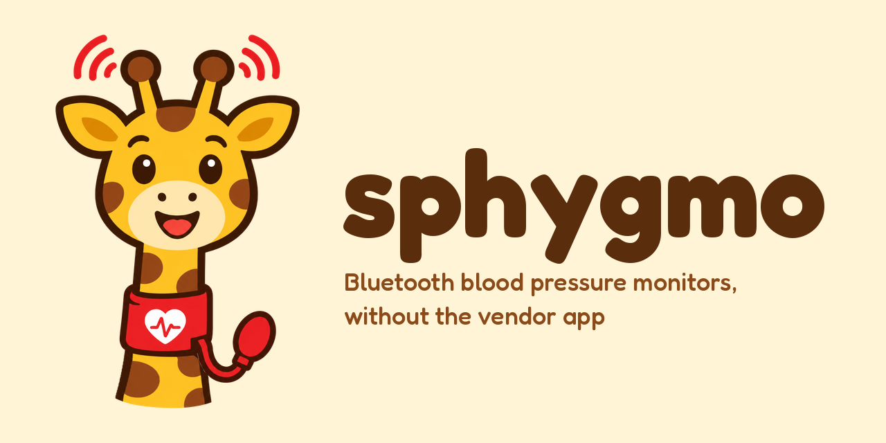

Read Bluetooth LE blood pressure monitors without the vendor app, and keep the readings
yourself. sphygmo talks to the monitor directly (for example a visomat cardiovision or
iProven BPM-2244 BT, which normally need the MedM app) and writes every reading to a local
file, ready for Home Assistant, FHIR or Apple Health.

sphygmo has two halves:

- **Drivers** speak a device protocol and turn packets into a common `Measurement`.
- **Sinks** store or export measurements. Today there is one: a JSON Lines file.

Planned next: sinks for Home Assistant, FHIR and Apple Health (via an iOS shortcut).

## Devices

| Device | Also sold as | Status | Driver |
|---|---|---|---|
| [visomat cardiovision](https://github.com/aeble/sphygmo/blob/main/docs/devices/visomat-cardiovision.md) | iProven BPM-2244 BT | works: pairing, live and buffered readings, 2 users | `transtek_7809` |
| Beurer BM 81 easyLock | | standard profile expected; untested, reports welcome | `bluetooth_bps` |
| any monitor with the [standard Blood Pressure Service](https://github.com/aeble/sphygmo/blob/main/docs/protocols/bluetooth-bps.md) (0x1810) | | driver written from the specification; untested on real devices | `bluetooth_bps` |
| Omron X7 Smart (AFib) | | wanted | |
| Withings BPM Connect | | BLE protocol unknown; readings also go to the Withings cloud over Wi-Fi, which has a public API | |
| Hilo (formerly Aktiia) | | cuffless bracelet, BLE probably encrypted; not planned | |

Other Transtek/Lifesense monitors that advertise a name like `1802A0` and expose service
`0x7809` probably work too.

**Have a different monitor?** A five-minute `sphygmo probe` run, or a capture of the vendor
app, is all it takes to start. See [docs/capturing.md](https://github.com/aeble/sphygmo/blob/main/docs/capturing.md) and open a device
report. [Related projects](https://github.com/aeble/sphygmo/blob/main/docs/related-projects.md) cover some other brands.

## Usage

With [uv](https://docs.astral.sh/uv/):

```bash
uv tool install sphygmo
sphygmo --jsonl measurements.jsonl
```

Without uv, in a virtual environment:

```bash
python3 -m venv ~/.venvs/sphygmo && ~/.venvs/sphygmo/bin/pip install sphygmo
~/.venvs/sphygmo/bin/sphygmo --jsonl measurements.jsonl
```

From a checkout of this repository, `uv run sphygmo` runs the current code.

Then take a measurement. The device connects on its own around each measurement and also
sends any readings it buffered while nobody was listening. Each reading is appended to the
file before it is acknowledged.

Pair each device once:

```bash
sphygmo --pair
```

then put the device into pairing mode (visomat: hold the Bluetooth button). Paired devices
are remembered in `~/.config/sphygmo/devices.json`; run without `--pair` afterwards. Devices
that are not paired get no response and their readings are ignored.

On macOS the terminal needs Bluetooth permission (System Settings, Privacy & Security,
Bluetooth).

## Security

Anything in radio range can advertise a matching name and send bytes. sphygmo serves only
paired devices, accepts pairing only with `--pair`, bounds each session to 120 s, skips
malformed packets, keeps control characters out of the log and creates its files readable
by the owner only. The protocols have no authentication, though: a device that copies the
serial number of a paired one is still accepted. Pair in a quiet moment and review readings
before exporting them.

## Survey an unsupported monitor

```bash
uvx sphygmo probe
```

Read-only: lists services and characteristics, records packets during a measurement and
writes `sphygmo-probe.json` without Bluetooth address and serial number. Details in
[docs/capturing.md](https://github.com/aeble/sphygmo/blob/main/docs/capturing.md).

## Adding a device

Implement `sphygmo.drivers.base.Driver`: `matches()` decides from the advertisement,
`run()` drives one connection, serves only devices in the trust store and awaits `emit()`
for every reading. Treat every packet as hostile input. Document the protocol
under `docs/protocols/`, with an anonymised capture under `docs/captures/` and tests built
from it.

## Status

Early. Protocols are reverse-engineered from captures and may be incomplete; see the open
points in each protocol document. Not a medical device, no warranty.

## License

Apache-2.0
